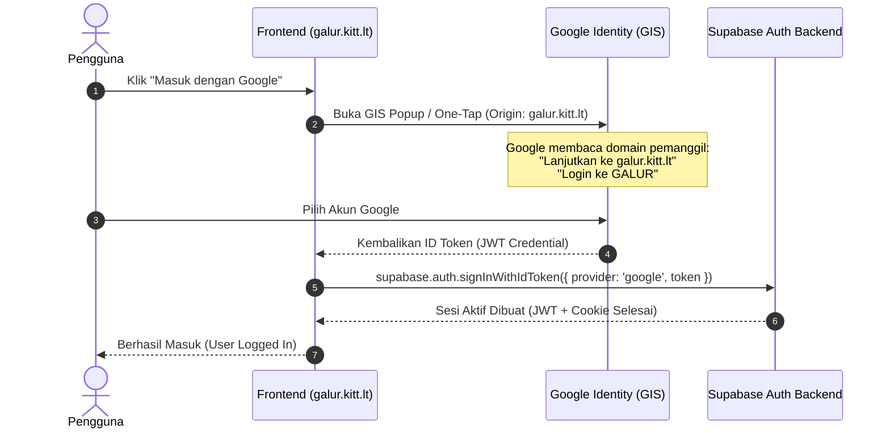

# Standar Arsitektur Autentikasi Google White-Label (SaaS Free-Tier)
**Ecosystem Standard: Bangkit Beruang & Next.js SaaS Applications**

Dokumen ini adalah standar resmi (*official blueprint*) untuk mengimplementasikan autentikasi Google OAuth dengan merek sendiri (*white-label*) pada layanan SaaS berbasis Next.js dan Supabase tanpa memerlukan biaya langganan Supabase Pro ($25/bulan).

---

## 1. Latar Belakang Masalah (The Problem)

Pada implementasi standar Supabase:
```ts
// KODE KONVENSIONAL (Memicu Masalah)
await supabase.auth.signInWithOAuth({
  provider: 'google',
  options: { redirectTo: '...' }
});
```

* **Penyebab**: Peramban dialihkan (*redirect*) ke backend Supabase (`https://<project-ref>.supabase.co/auth/v1/authorize`).
* **Akibat**: Google OAuth membaca alamat *redirect* tersebut dan menampilkan teks keamanan wajib di layar login pengguna:
  $$\text{"Lanjutkan ke <project-ref>.supabase.co"}$$
* **Dampak**: Estetika aplikasi berkurang, tampak tidak profesional, dan menimbulkan keraguan keamanan bagi pengguna awam.
* **Solusi Bawaan Supabase**: Membeli paket Supabase Pro + Custom Domain Add-on seharga **$25/bulan**.

---

## 2. Solusi Standar: Google Identity Services (GIS) + `signInWithIdToken`

Solusi gratis dan 100% *white-label* memanfaatkan fitur **Google Identity Services (OIDC Client-Side)** yang dipadukan dengan API Supabase `signInWithIdToken`.



---

## 3. Komponen & Langkah Implementasi Standar

### Langkah 1: Pengaturan di Google Cloud Console
1. Buka **Google Cloud Console ➔ APIs & Services ➔ Credentials**.
2. Pada **OAuth 2.0 Client ID (Web Application)**:
   * **Authorized JavaScript origins**:
     * `https://<domain-resmi-anda>` (misal: `https://galur.kitt.lt`)
     * `http://localhost:3000` (untuk pengujian lokal)
   * **Authorized redirect URIs**:
     * `https://<project-ref>.supabase.co/auth/v1/callback` (tetap biarkan sebagai cadangan backend)
3. Pada **OAuth consent screen**:
   * **App name**: Nama Resmi SaaS (misal: `GALUR`).
   * **App logo**: Logo resmi (1:1, format PNG/JPG).
   * **Application home page**: URL landing page resmi.
   * **Authorized domains**: Tambahkan domain utama (misal: `kitt.lt`).

---

### Langkah 2: Pemasangan Script GIS di Next.js (`layout.tsx`)
Tambahkan script Google Identity Services ke `src/app/layout.tsx`:
```tsx
import Script from 'next/script';

export default function RootLayout({ children }: { children: React.ReactNode }) {
  return (
    <html lang="id">
      <body>
        {children}
        <Script src="https://accounts.google.com/gsi/client" strategy="afterInteractive" />
      </body>
    </html>
  );
}
```

---

### Langkah 3: Komponen Tombol Universal (`GoogleSignInButton.tsx`)
Gunakan komponen standar yang merender tombol resmi Google Identity Services dan otomatis memicu `signInWithIdToken`:

```tsx
'use client';

import React, { useEffect, useRef, useState } from 'react';
import { supabase } from '@/lib/supabase';

interface Props {
  onSuccess?: () => void;
  width?: number;
}

export default function GoogleSignInButton({ onSuccess, width = 240 }: Props) {
  const containerRef = useRef<HTMLDivElement>(null);
  const [isRendered, setIsRendered] = useState(false);

  useEffect(() => {
    const initGIS = () => {
      if (!window.google?.accounts?.id || !containerRef.current) return false;

      window.google.accounts.id.initialize({
        client_id: process.env.NEXT_PUBLIC_GOOGLE_CLIENT_ID!,
        callback: async (res: any) => {
          if (!res?.credential) return;
          const { error } = await supabase.auth.signInWithIdToken({
            provider: 'google',
            token: res.credential,
          });
          if (!error && onSuccess) onSuccess();
        },
      });

      window.google.accounts.id.renderButton(containerRef.current, {
        theme: 'outline',
        size: 'large',
        text: 'continue_with',
        shape: 'pill',
        width,
      });

      setIsRendered(true);
      window.google.accounts.id.prompt(); // Memicu Google One-Tap jika tersedia
      return true;
    };

    if (!initGIS()) {
      const timer = setInterval(() => {
        if (initGIS()) clearInterval(timer);
      }, 250);
      return () => clearInterval(timer);
    }
  }, [width, onSuccess]);

  return <div ref={containerRef} />;
}
```

---

## 4. Keuntungan Skema Ini

| Kriteria | Skema Tradisional (`signInWithOAuth`) | Skema Standar Ini (`signInWithIdToken`) |
| :--- | :--- | :--- |
| **Domain Tampil di Google** | `*.supabase.co` | `domain-anda.com` (100% White-Label) |
| **Biaya Bulanan** | Gratis / $25 jika beli custom domain | **$0 (100% Gratis Selamanya)** |
| **UX & Kecepatan** | Full-page browser redirect | In-app popup atau One-Tap instan |
| **Keamanan** | Standar OAuth 2.0 PKCE | Standar OpenID Connect (OIDC) JWT |
| **Dukungan Supabase Free** | Ya | Ya (Didukung resmi oleh Supabase JS SDK) |

---
*Standar ini diadopsi secara resmi pada proyek GALUR (17 Oktober 2026).*
